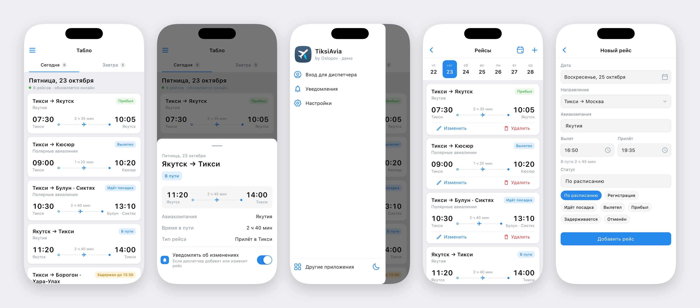
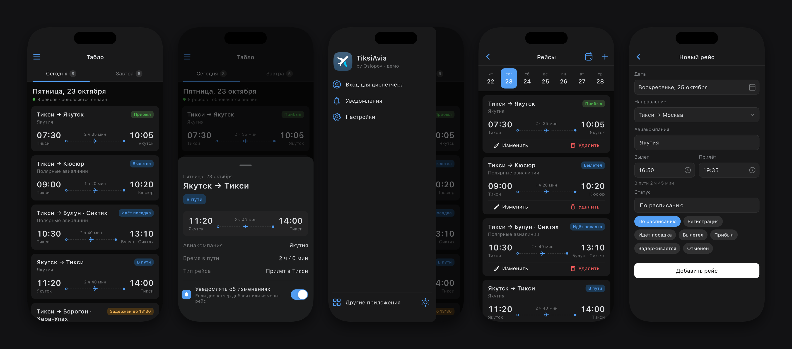

# TiksiAvia

Онлайн-табло самолётов и вертолётов аэропорта Тикси. Пассажиры видят рейсы на сегодня и завтра в реальном времени и подписываются на push-уведомления по нужным направлениям; диспетчеры публикуют и редактируют расписание из приложения.

Интерфейс построен по дизайн-системе [VKUI](https://vkcom.github.io/VKUI/): цвета, типографика и размеры взяты из токенов `@vkontakte/vkui-tokens` (темы `vkIOS` / `vkIOSDark`), компоненты повторяют `PanelHeader`, `Group`, `SimpleCell`, `FormItem`, `Button`, `SegmentedControl`, `Placeholder`, `Snackbar`.




## Возможности

### Пассажиру

- табло на сегодня и завтра с обновлением в реальном времени;
- карточка рейса: маршрут, время вылета и прилёта, время в пути, статус с цветовой индикацией;
- подробности рейса и подписка на уведомления прямо из карточки;
- push-уведомления по 18 направлениям;
- светлая, тёмная и системная темы.

### Диспетчеру

- вход по email и паролю, восстановление пароля;
- сводка рейсов на сегодня и завтра;
- лента дат, добавление, редактирование и удаление рейсов с подтверждением;
- быстрые статусы («По расписанию», «Регистрация», «Вылетел»…).

## Стек

Flutter 3.47 / Dart 3 · Firebase (Realtime Database, Auth, Cloud Messaging) · Hive · Provider · flutter_svg

```text
lib/
  data/        модель рейса, маршруты, AviaRepository + реализации Firebase и Demo
  theme/       токены VKUI (VkColors, VkTypography) и ThemeData
  components/  VKUI-компоненты и карточка рейса
  pages/       экраны
  demo/        демо-сцены для скриншотов
```

UI работает только с интерфейсом `AviaRepository`, поэтому приложение запускается и на Firebase, и на встроенных демо-данных.

## Запуск

Демо без Firebase (тестовое расписание, вход с любыми данными):

```sh
flutter run --dart-define=DEMO=true
```

С Firebase нужны `android/app/google-services.json` и `ios/Runner/GoogleService-Info.plist` (в репозиторий не входят):

```sh
flutter run
```

Тесты: `flutter test`.

## Скриншоты

`tool/screenshots.sh` собирает демо, ставит его в симулятор iPhone с Dynamic Island и снимает 12 экранов в светлой и тёмной темах в `screenshots/`. Статус-бар (часы, сеть, батарея) в этом режиме скрыт, Dynamic Island и скругления экрана сохраняются.

```sh
tool/screenshots.sh
DEVICE="iPhone 17 Pro Max" tool/screenshots.sh
```

## Push-уведомления

Приложение подписывает устройство на FCM-топик направления. Рассылку при добавлении или изменении рейса должен делать сервер, например Cloud Function на запись в Realtime Database: устаревший FCM HTTP API, через который приложение раньше отправляло уведомления само, Google отключил в 2024 году.
